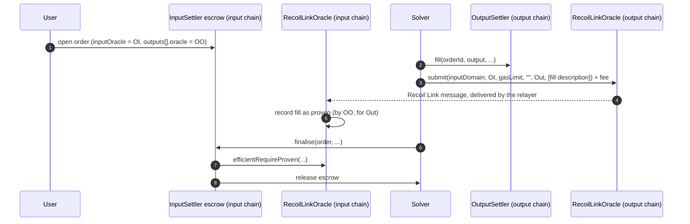

# Prove intent fills with RecoilLinkOracle

In an intent system, a solver delivers funds on the **output chain** and is paid from an escrow on the **input chain**. The escrow needs proof that the fill happened. `RecoilLinkOracle` provides that proof over Recoil Link for [Open Intents Framework](https://github.com/openintentsframework/oif-contracts) (OIF) settlers, replacing development-only oracles such as `AlwaysYesOracle`, which approve every claim.

[RecoilPay](https://v2.recoilpay.com) uses it for EVM↔EVM swaps between Recoil Link networks.

## What it is

`RecoilLinkOracle` is OIF's `HyperlaneOracle` with no added logic: Recoil Link keeps the Mailbox interface, so the audited upstream oracle works unchanged. One oracle is deployed per chain; addresses are on [Networks](../reference/networks.md). It has no owner and no admin functions, and it verifies proofs with the Mailbox's default ISM (the Recoil Link validator set).

## The flow



1. The **order** names the input chain's oracle as `inputOracle` and the output chain's oracle in each output's `oracle` field.
2. After filling, anyone (usually the solver) calls **`submit`** on the output chain's oracle with the settler and the fill descriptions, paying `quoteGasPayment`. The oracle checks with the settler that the fill happened (`hasAttested`) and sends the descriptions over Recoil Link.
3. Once delivered, the input chain's oracle records each fill **under the sending oracle's identity**. The escrow's `finalise` checks it with `efficientRequireProven` and pays the solver.

## Calls

```solidity
// On the output chain, after the fill:
uint256 fee = outputOracle.quoteGasPayment(inputDomain, address(inputOracle), gasLimit, "", outputSettler, payloads);
outputOracle.submit{value: fee}(inputDomain, address(inputOracle), gasLimit, "", outputSettler, payloads);

// On the input chain, to check before finalising:
bool proven = inputOracle.isProven(outputDomain, bytes32(uint256(uint160(address(outputOracle)))),
                                   bytes32(uint256(uint160(outputSettler))), keccak256(payload));
```

Each payload is the fill description OIF's `MandateOutputEncodingLib.encodeFillDescription` produces: solver, order id, fill timestamp, token, amount, recipient, callback data and context.

## Things to know

- **Proofs are bound to the oracle the order names.** Anyone can send messages to the input oracle, but they are recorded under the sender's identity, so a forged proof from another address does not satisfy an order that named `outputOracle`.
- **The settler only attests to the oracle named in the output.** Call `hasAttested` as that oracle (`eth_call` with `from` = oracle) if you check it off-chain.
- **Give orders enough time.** A proof arrives 10 seconds to a few minutes after `submit`. If an order can be refunded before its proof lands, the solver can lose a fill it already paid for. RecoilPay gives Recoil Link routes a 30-minute expiry and refuses fills with less than 20 minutes left.
- **Both chains need an oracle.** A route only works if the output chain's oracle can send to the input chain's. Use Recoil Link oracles on both sides or neither.
- **Domain ids equal chain ids** on every EVM network Recoil Link supports, so `HyperlaneOracle`'s identity mapping applies. Routes to chains with different domain ids use OIF's `HyperlaneOracleMapped`.

## Deploying your own

The oracle has no state worth sharing, so you can also deploy your own against a Recoil Link Mailbox: see [`oif-oracle/`](https://github.com/recoil-labs/recoil-link/tree/main/oif-oracle) (`deploy.sh`, end-to-end tests against the real Mailbox).
