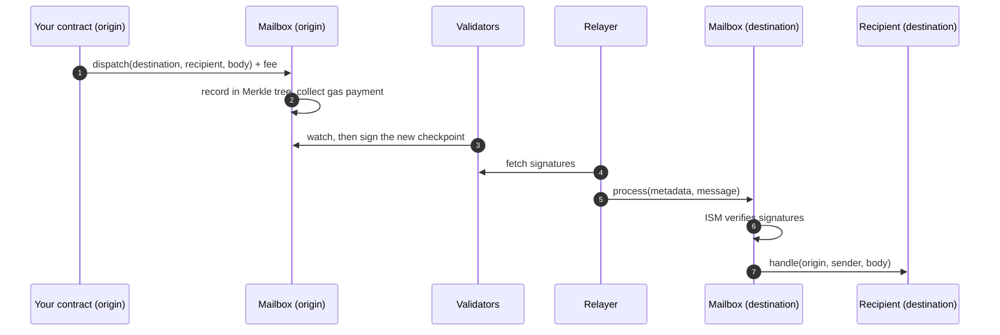

# How it works

A message passes through contracts on two chains and two kinds of off-chain agent. **Validators** attest that it was sent; the **relayer** carries that proof to the destination, where a security module checks it.


Step by step, every message goes through the same five stages:



1. **Dispatch.** Your contract calls `dispatch` on its chain's Mailbox with the destination domain, the recipient and the message body, paying the quoted fee. The Mailbox returns a `messageId`.
2. **Hooks.** The Mailbox runs its hooks: the **Merkle tree hook** adds the message to an append-only tree, and the **interchain gas paymaster (IGP)** records the gas payment.
3. **Attestation.** Validators watch the Mailbox and sign checkpoints (the Merkle root and the latest message) once the origin block is final enough. Signatures are published to storage the relayer can read.
4. **Delivery.** The relayer picks up messages that paid for gas, collects enough validator signatures, and calls `process` on the destination Mailbox, paying the destination gas itself.
5. **Verification and handling.** The destination Mailbox asks the recipient's **interchain security module (ISM)** to verify the signatures. If they pass, it marks the message delivered (exactly once) and calls the recipient's `handle`.

## Domains

Chains are identified by a **domain id** (`uint32`). For every EVM chain Recoil Link supports, the domain id equals the chain id: Sepolia is `11155111`, Base Sepolia `84532`. See [Networks](./reference/networks.md).

## Addresses as `bytes32`

Senders and recipients are `bytes32`, so non-EVM chains fit. An EVM address is left-padded with zeros:

```solidity
bytes32 recipient = bytes32(uint256(uint160(recipientAddress)));
```

## Timing

On testnet, delivery takes **20–140 seconds**. Most of it is the origin chain's finality: validators sign only after the block is final enough not to be reorganised (BSC testnet waits longest).

## Who pays

The **sender** pays once, on the origin chain, in its native token: destination gas plus margin (see [Gas and fees](./build/gas-and-fees.md)). Recoil Labs' relayer pays the destination gas. The fee goes to the gas paymaster, whose beneficiary is the Recoil Labs treasury, and the treasury funds the relayer (see [Operators](./operate/operators.md#what-a-relayer-gets)). The recipient pays nothing.
