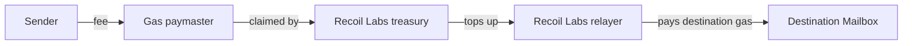

# Operators: who runs Recoil Link

Recoil Link depends on two kinds of operator. **Validators** decide what is true; **relayers** only carry it. What each does is in [Validators and relayer](../learn/agents.md); this page covers who should run them and what they get out of it.

## Validators

### Who should run one

A destination accepts a message when it carries signatures from a threshold of validators, so the validator set _is_ the security. It is only as strong as its members are independent of each other. Good validator operators are:

- **Infrastructure and staking operators**: running validators for many networks is already their business.
- **Applications that depend on Recoil Link**: a team whose own funds move over Recoil Link has every reason to keep it honest.
- **Ecosystem partners** on the chains Recoil Link supports.

Today every chain has one validator, run by Recoil Labs. Before mainnet each set grows to several operators run by different parties (see [Security](./security.md)).

### What a validator operator commits to

- **Signing only what's final.** Never sign a checkpoint before the origin chain's reorg period has passed.
- **Protecting one key.** The signing key belongs in a cloud KMS or an HSM, never in a file.
- **Staying up.** A private RPC endpoint for each chain it validates, and monitoring of how far behind its latest signed checkpoint is.
- **Staying reachable.** A contact who can respond to an incident.

A validator sends no transactions after its one-time announcement and needs no gas. The cost is a small server, RPC access and a storage bucket per chain.

### What a validator gets

The protocol pays validators nothing automatically: no contract sends fees to them. Operators join by arrangement with Recoil Labs. Adding a validator means adding its address to each chain's security module, which only the contract owner can do. To run one, [contact Recoil Labs](https://github.com/recoil-labs).

### Accountability

A validator's signatures are public, and some false checkpoints are provable on-chain. The contracts Recoil Link is built on include `AttributeCheckpointFraud`, which records the signer of a checkpoint whose root or message id contradicts the origin chain's Merkle tree, or which was signed ahead of it. It is not deployed on Recoil Link's testnets yet.

## Relayers

### Who runs one

- **Recoil Labs** runs the relayer that delivers all messages that paid the default fee.
- **Applications** may relay their own messages, for example to control timing. Anyone can call `process` with valid signatures.

### What a relayer gets

When a message is sent, the sender pays a fee to the chain's **interchain gas paymaster**, not to a relayer. The paymaster's beneficiary is the Recoil Labs treasury (`0x020BC752682191Fa9997B3307A8FC9710aeA3365`), which funds Recoil Labs' relayer:

A third-party relayer that delivers those messages pays the destination gas itself and is not reimbursed. To be paid for relaying your own app's messages, deploy your own gas paymaster and dispatch with a hook that aggregates it with the chain's Merkle tree hook. Leaving the Merkle tree hook out means validators never see the message.

### What a relayer operator commits to

RPC access to every chain it serves, a funded wallet on every destination, and alerts on its message queue and balances. One running instance per relayer key, so two instances don't race each other's nonces.

## At mainnet

The validator set grows to several independent operators per chain with a matching threshold, contract ownership moves to a multi-signer Safe, and Recoil Link's changes are audited. [Security](./security.md) tracks each item.
