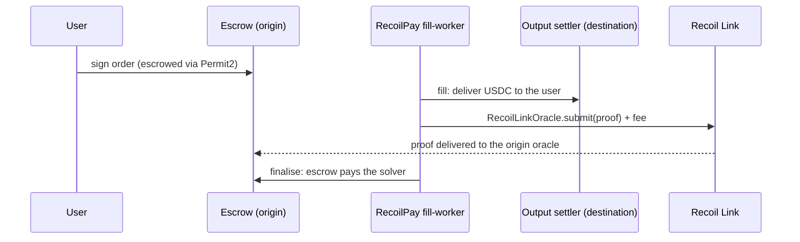

# Case study: RecoilPay

[RecoilPay](https://v2.recoilpay.com) turns a sentence ("send 50 USDC to Sam on Base") into a cross-chain swap. It is an **intent system** on the [Open Intents Framework](https://github.com/openintentsframework/oif-contracts): the user's funds are escrowed on the origin chain, a solver delivers on the destination with its own funds, and the escrow pays the solver once the delivery is **proven**. Recoil Link is that proof.

## Before

EVM↔EVM routes on testnet used an `AlwaysYesOracle`, which approves every claim: a solver could have been paid without delivering anything. It was never usable on mainnet.

## After

Between Recoil Link networks, RecoilPay's quotes name a [`RecoilLinkOracle`](../build/prove-intent-fills.md) on both chains, and its fill-worker proves each fill before claiming:

## Measured on testnet

| Route                    | Order to finalized | Proof (submit to proven) |
| ------------------------ | ------------------ | ------------------------ |
| Base Sepolia → Sepolia   | 72 s               | 31 s                     |
| BSC testnet → OP Sepolia | 21 s               | 10 s                     |

The user receives funds on the destination within seconds of the order; the proof only affects when the solver is paid.

## Design choices worth copying

- **Recoil Link on both sides or neither.** A route uses Recoil Link oracles only if both chains have one; otherwise an escrow could wait for a proof the other side cannot send.
- **Probe the oracle, not a config flag.** Before filling, the worker asks the order's input oracle whether an impossible fill is proven. An `AlwaysYesOracle` says yes (no proof needed); a `RecoilLinkOracle` says no.
- **Leave time for the proof.** Recoil Link routes get a 30-minute order expiry, and the worker refuses fills with less than 20 minutes left, so a refund can never race a proof.
- **Pay the quote.** The worker calls `quoteGasPayment` and sends exactly that with `submit`.
